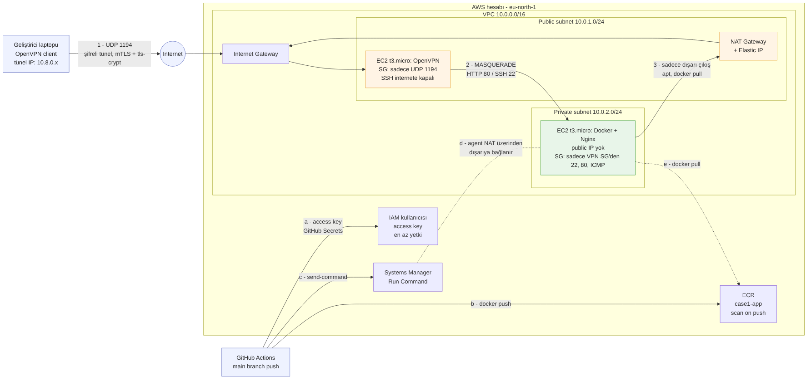
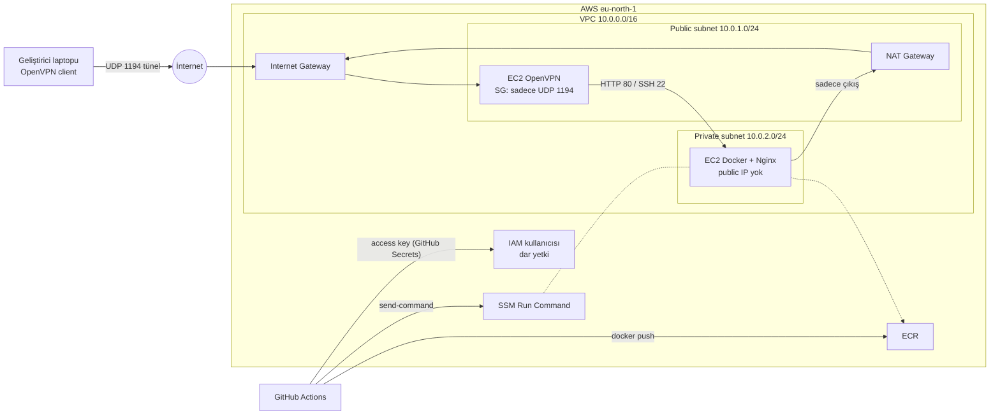

# DevOps Case 1: VPN arkasında private uygulama (AWS + Terraform)

Bir e-ticaret şirketinin iç uygulamasını, **internetten hiçbir şekilde erişilemeyen** bir private subnet'te çalıştıran ve sadece **OpenVPN ile kimliği doğrulanmış kullanıcıların** erişebildiği altyapı.

Bütün altyapı **Terraform** ile tanımlı. Tek bir `terraform apply` ile VPN sunucusu, sertifikalar ve uygulama sunucusu dahil her şey sıfırdan, yaklaşık 5 dakikada kuruluyor. Elle yapılan bir adım yok.

---

## Mimari



<details>
<summary>Mermaid kaynağı (GitHub otomatik çizer)</summary>


</details>

### Bileşenler
- **VPC `10.0.0.0/16`:** Uygulamanın yaşadığı izole ağ.
- **Public subnet `10.0.1.0/24`:** Route table'ında `0.0.0.0/0 → Internet Gateway` yolu var. Burada sadece iki şey duruyor: VPN sunucusu ve NAT Gateway.
- **Private subnet `10.0.2.0/24`:** IGW'ye giden yolu yok, sadece `0.0.0.0/0 → NAT Gateway` yolu var. Makineler public IP almıyor.
- **OpenVPN sunucusu (EC2):** İnternete açık **tek kapı**, UDP 1194. VPN istemcilerinden gelen trafiği private subnet'e iletiyor (IP forwarding + NAT/MASQUERADE).
- **Uygulama sunucusu (EC2):** Docker içinde Nginx çalışıyor. Sadece VPN sunucusunun Security Group'undan gelen trafiği kabul ediyor.
- **NAT Gateway:** Private sunucunun **dışarıya** çıkabilmesi için var: paket kurulumu, `docker pull`, SSM. İçeriye doğru bağlantı kabul etmiyor.
- **CI/CD:** GitHub Actions imajı build edip **ECR**'a push ediyor, sonra private sunucuya **SSM Run Command** ile deploy ediyor.

### Bir isteğin yolculuğu (laptop → Nginx)
1. Laptopta tarayıcıya `http://10.0.2.x` yazılıyor. OpenVPN'in eklediği route, `10.0.0.0/16` trafiğini tünele yönlendiriyor.
2. Paket şifrelenip UDP 1194 üzerinden VPN sunucusunun public IP'sine gidiyor (IGW → VPN SG kontrolü).
3. VPN sunucusu paketi açıyor. IP forwarding ile private subnet'e iletiyor, iletirken MASQUERADE ile kaynak adresi kendi private IP'sine çeviriyor.
4. Uygulama sunucusunun Security Group'u paketin VPN SG'sinden geldiğini görüyor ve 80 numaralı porta izin veriyor.
5. Nginx cevap veriyor. Cevap aynı yoldan tünele, oradan laptopa dönüyor.

---

## Güvenlik kararları ve gerekçeleri

1. **Private sunucunun public IP'si ve IGW yolu yok.** İnternetten erişimi engelleyen asıl şey routing. Security Group bunun üstüne ikinci bir katman.
2. **İnternete açık tek port UDP 1194.** SSH internete kapalı. Sunuculara yönetim erişimi sadece VPN tünelinin içinden yapılıyor (`ssh ubuntu@<vpn_private_ip>`). Tünelden gelen trafik VPN sunucusunun içinde açıldığı için Security Group'a uğramıyor.
3. **Karşılıklı sertifika doğrulaması (mutual TLS).** Hem sunucu hem client, aynı CA tarafından imzalanmış sertifika gösteriyor. `remote-cert-tls server` ayarı, geçerli bir client sertifikasıyla sahte sunucu kurulmasını engelliyor.
4. **`tls-crypt`.** Doğru paylaşılan anahtarı göstermeyen paketlere sunucu hiç cevap vermiyor. Port taramalarına karşı UDP 1194 "kapalı" gibi görünüyor, el sıkışma da şifreli gidiyor.
5. **Security Group'lar IP yerine birbirine referans veriyor.** Uygulama SG'si "VPN SG'sinden gelen" trafiğe izin veriyor. VPN sunucusunun IP'si değişse bile kural geçerliliğini koruyor.
6. **OpenVPN root yetkilerini bırakıyor.** `user nobody` / `group nogroup` ayarı sayesinde servis başladıktan sonra yetkisiz kullanıcıya geçiyor.
7. **Split tunnel.** Tünelden sadece `10.0.0.0/16` trafiği geçiyor. Kullanıcının normal internet trafiği şirkete taşınmıyor.
8. **SSH anahtarı lokalde üretiliyor.** Private key bilgisayardan hiç çıkmıyor, AWS'ye sadece public key yükleniyor.
9. **CI/CD anahtarı dar yetkili ve kısa ömürlü tutuluyor.** GitHub Actions bir IAM kullanıcısının access key'iyle giriyor (OIDC bu hesapta SCP ile yasak, aşağıda trade-off'lar bölümüne bak). Anahtar sadece GitHub Secrets'ta duruyor, fork PR'ları secret'lara erişemiyor, workflow sadece `main` branch'inde çalışıyor. Her `destroy`'da anahtar siliniyor, her `apply`'da yenisi üretiliyor.
10. **En az yetki.** GitHub kullanıcısı sadece bu ECR reposuna push edebiliyor ve sadece uygulama sunucusunda komut çalıştırabiliyor. Anahtar sızsa bile saldırgan başka hiçbir kaynağa dokunamıyor. Uygulama sunucusunun ECR yetkisi sadece okuma.
11. **SSM ile deploy, port açmadan.** SSM agent NAT üzerinden AWS'ye **dışarıya doğru** bağlanıyor. Deploy için hiçbir gelen port açılmıyor.
12. **ECR `scan_on_push`.** Her imaj push edildiğinde bilinen açıklar için taranıyor.
13. **Gizli dosyalar Git'te yok.** `.gitignore` ile state, `.ovpn` ve key dosyaları repodan hariç tutuluyor.

### Bilerek kabul edilen trade-off'lar
- **Sertifika private key'leri Terraform state'inde ve EC2 user_data'sında duruyor.** Bu sayede kurulum tamamen otomatik. Üretim ortamında state şifreli bir remote backend'de (S3 + KMS) tutulmalı, sertifikalar da Secrets Manager'dan IAM rolüyle çekilmeli.
- **CI/CD için kalıcı access key.** İlk tasarım GitHub Actions + OIDC'ydi. Ama bu hesap AWS'nin yeni kayıt deneyimiyle açıldı ve üstündeki değiştirilemeyen SCP `iam:*Provider*` işlemlerini yasaklıyor (`AccessDenied ... explicit deny in a service control policy`). GitHub Actions'ta kalmak için bir IAM kullanıcısının access key'i kullanıldı. Risk dar yetki, kısa ömür (destroy/apply ile yenileniyor) ve secret'ların sadece main branch'inde kullanılmasıyla sınırlandı. OIDC'ye izin veren bir hesapta doğru çözüm OIDC olurdu. Alternatif olarak AWS CodePipeline + CodeBuild de denendi, o yolda kalıcı anahtar hiç gerekmiyor.
- **Tek AZ, tek NAT, tek VPN sunucusu.** Maliyet için. Yüksek erişilebilirlik gerekirse ikinci bir AZ eklenmeli.
- Tam liste ve iyileştirme önerileri: [docs/TESTS.md](docs/TESTS.md)

---

## Repo yapısı
```
.
├── terraform/
│   ├── main.tf        # provider'lar, VPC, subnet'ler, IGW, public route table
│   ├── pki.tf         # CA, sunucu ve client sertifikaları, tls-crypt anahtarı
│   ├── vpn.tf         # VPN SG + OpenVPN EC2 (user_data ile otomatik kurulum)
│   ├── private.tf     # NAT, private route table, app SG + app EC2
│   ├── client.tf      # client1.ovpn dosyasını lokale üretir
│   └── cicd.tf        # ECR, EC2 IAM rolü, GitHub Actions için dar yetkili IAM kullanıcısı
├── app/
│   ├── Dockerfile
│   └── index.html
├── .github/workflows/deploy.yml
├── scripts/deploy.sh  # SSM ile deploy + sağlık kontrolü
└── docs/
    ├── architecture.png / architecture.mmd
    ├── CICD.md        # CI/CD kurulum rehberi
    ├── TESTS.md       # test planı, bulgular, iyileştirmeler
    └── screenshots/
```

---

## Kurulum

### Gereksinimler
- AWS hesabı ve AWS CLI v2.32+ (`aws login` ile giriş)
- Terraform 1.x
- OpenVPN Connect (ya da Tunnelblick)
- SSH anahtarı: `ssh-keygen -t ed25519 -f ~/.ssh/case1`

### Adımlar
```bash
aws login
cd terraform
terraform init
terraform apply
```
1. Apply bitince makinelerin kendi kurulumlarını tamamlaması için **3-4 dakika bekle.**
2. `terraform/client1.ovpn` dosyasını OpenVPN Connect'e yükle ve bağlan.
3. Test et:
   ```bash
   terraform output
   ping -c 3 $(terraform output -raw app_private_ip)
   curl http://$(terraform output -raw app_private_ip)
   ```
4. Yönetim erişimi (VPN bağlıyken):
   ```bash
   ssh -i ~/.ssh/case1 ubuntu@$(terraform output -raw vpn_private_ip)
   ssh -i ~/.ssh/case1 ubuntu@$(terraform output -raw app_private_ip)
   ```

## CI/CD
`app/` klasörüne yapılan her push şu adımları tetikliyor:
```
GitHub Actions → (GitHub Secrets'taki access key) → docker build → ECR push → SSM ile private sunucuda pull + restart + sağlık kontrolü
```
Kurulum adımları: [docs/CICD.md](docs/CICD.md)

## Doğrulama
- `docs/screenshots/vpn-on.png`: VPN açıkken uygulama açılıyor.
- `docs/screenshots/vpn-off.png`: VPN kapalıyken uygulama açılmıyor.
- `docs/screenshots/actions.png`: Başarılı bir CI/CD çalışması.
- `docs/screenshots/deployed.png`: Deploy edilen versiyon.

## Maliyet (yaklaşık)
- **NAT Gateway:** Saatlik ücret ve işlenen veri başına ücret. Bu altyapıdaki en büyük kalem.
- **Public IPv4:** VPN sunucusu ve NAT'ın Elastic IP'si için saatlik ücret.
- **2 × t3.micro:** Free Tier kapsamında.

Kullanılmadığında `terraform destroy` ile her şey kapatılıyor.

## Temizlik
```bash
cd terraform
terraform destroy
```
